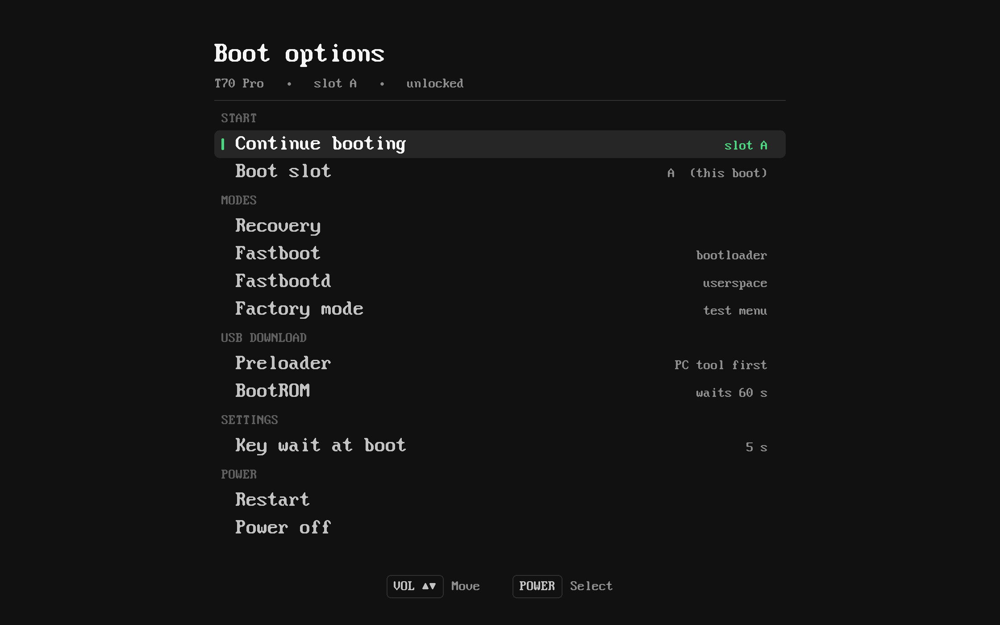

# t70pro-lkmenu

A boot menu for the Teclast T70 Pro (MediaTek MT6789), built into the stock
`lk` bootloader stage — in the spirit of lk2nd, but on MediaTek's own LK.

Goal: boot normally by default; press any key during the stock boot wait
to get a menu (slot A/B, recovery, fastboot, download mode, SD card,
EDK2/UEFI, power off), with the default kept in `misc`.

**Status:** first menu. The stock orange-state screen (the unlocked-device
warning and its 5 s wait) is replaced (hook in `hooks.txt`): the boot logo
stays, with only a 1 px line along the bottom edge running down; any key
opens the menu (volume moves, power selects):

- Continue booting / Boot slot A or B: "Boot slot" only switches the active
  slot flag in `misc`; Continue boots on, or restarts into the other slot
  if that is the one chosen (also after 60 s without a key)
- Recovery, Fastboot (bootloader), Fastbootd (userspace): this slot's
- Factory mode: the boot goes on in factory mode, as with volume up held at
  power-on
- USB download (`src/download.c`):
  - Preloader: a restart with no key held, so the preloader looks for a PC
    tool (it skips that while power is held, as after a forced power-off)
  - BootROM: the stock preloader's emergency download (volume up + down +
    power at power-on) with a 60 s wait instead of 5 s: `BOOT_MISC0` in the
    always-on security block, then a watchdog reset
- Key wait at boot 5/3/1 s or off, saved in `misc` at 0x3000 (`struct t70_cfg`)
- Fastboot (stock) no longer resets after about 30 s: the stock lk leaves
  its 30 s hardware watchdog running and the fastboot loop never restarts
  it; a hook stops it when fastboot starts, as the stock key menu does
  (`src/fastboot.c`)
- Restart, Power off

Power still held from switching the tablet on does not open the menu; a
volume key held while booting does. With the wait off the screen is left as
it is and only a held volume key opens the menu. A boot whose mode is
already chosen (recovery, factory, META, fastboot, download) does not wait.
SD card boot, `fastboot boot` (missing from the stock fastboot) and EDK2
boot are not done yet. Checked by `make test` (menu logic and drawing on
the host), `make relocheck` and `make check`.

On the device (slot B, 2026-11-25) the first drawn menu showed nothing,
though it ran (the menu even opened). The diagnostic build
(`make OUT=out/diag DIAG=1 ...`: two lines of stock console text, and a
record of what the wait saw in misc at 0x3200, read with `tools/lk_diag.py`)
showed why: the console page lies over the boot logo page and its top byte
is alpha. The stock console writes text with 0xff; we wrote 0, so everything
was transparent. Now all drawing is opaque, and the countdown leaves the
page transparent but for its line, so the boot logo stays on screen while
it runs and after it, as with the stock warning.

The menu draws straight into the frame buffer of the stock `lk` console
(`src/gfx.c`) with the stock 8x16 font enlarged 2-4x and smoothed
(Scale2x/Scale3x). The colours are greys and a green, chosen so that they
look right whichever order the panel takes red and blue in (not yet checked
on the device).

The pictures are not photos: `make demo` runs the menu code on the build host
with a 2240x1400 frame buffer and the font of your stock `lk`
(`out/demo/countdown.png`, `menu.png`, `notice.png`, and
[`menu-demo.png`](docs/menu-demo.png) as an animation).

## How it works

This repository contains no MediaTek code. At build time:

1. `tools/lk_img.py` splits your stock `lk.img` (G3D1 V1.08 only; checked by
   SHA-256) and takes out the `lk` (BL33) payload.
2. `tools/lk_disasm.py` turns that payload into re-assemblable GNU assembler
   source under `out/gen/`: every branch, literal, adrp/`:lo12:` pair, switch
   table and data pointer becomes a symbol, so the code can move and grow.
   Without hooks it rebuilds the stock payload byte for byte (`make check`).
3. `names.txt` gives our names to stock functions and data (linker aliases);
   `hooks.txt` replaces a few stock instructions with calls into `src/`.
4. `build.mk` assembles the generated source, compiles `src/*.c`, links them
   with the generated layout and `tools/lk_img.py` packs `out/lk.img` with the
   other stock stages (`bl2_ext`, `aee`, device trees, certificates) unchanged.

`make relocheck` compares the result with the stock payload: every stock
branch, literal, adrp pair, pointer and jump-table entry must still reach its
(moved) target, and every other stock word must be unchanged.

## Build (Linux, aarch64 cross binutils + gcc, Python 3 with capstone)

    make STOCK_LK_IMG=/path/to/stock/lk.img -j        # -> out/lk.img
    make check STOCK_LK_IMG=/path/to/stock/lk.img     # generated source == stock lk
    make relocheck STOCK_LK_IMG=/path/to/stock/lk.img
    make test                                         # menu logic, host compiler
    make demo STOCK_LK_IMG=/path/to/stock/lk.img      # pictures of the screens -> out/demo/
    make OUT=out/diag DIAG=1 STOCK_LK_IMG=/path/to/stock/lk.img   # diagnostic build -> out/diag/lk.img

Stock `lk.img`: sha256 `18f56d90f25692f8547840b644f405aae7769a97e780acbdf7f076b737c20846`,
`lk` payload sha256 `05e0155f32c46109cad92b46e65d4943852b91c84d19c99d2e52d49443cf33b4`.

The image only works on a device whose bootloader is unlocked (the stock
preloader and bl2_ext then accept a changed `lk`). Keep a copy of your stock
`lk_a`/`lk_b` and a way to restore them (preloader/BROM download mode) before
flashing anything.

## License

GPL-3.0-or-later (see `LICENSE`).
