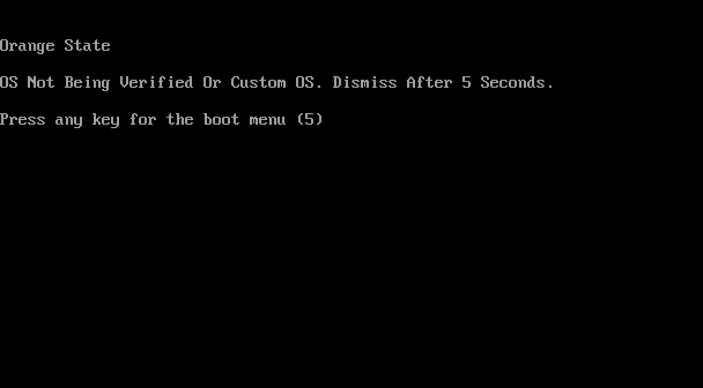

# t70pro-lkmenu

A boot menu for the Teclast T70 Pro (MediaTek MT6789), built into the stock
`lk` bootloader stage — in the spirit of lk2nd, but on MediaTek's own LK.

Goal: boot normally by default; press any key during the stock boot wait
to get a menu (slot A/B, recovery, fastboot, download mode, SD card,
EDK2/UEFI, power off), with the default kept in `misc`.

**Status:** first menu. The stock orange-state screen (the unlocked-device
warning and its 5 s wait) is replaced (hook in `hooks.txt`): the screen shows
only "Press any key for the boot menu" with a countdown, and any key opens
the menu (volume moves, power selects):

- Continue (boot this slot) / Switch to the other slot and reboot
- Recovery, Fastboot (bootloader), Fastbootd
- Menu key wait 5/3/1/0 s, saved in `misc` at 0x3000 (`struct t70_cfg`)
- Reboot, Power off

Power still held from switching the tablet on does not open the menu; a
volume key held while booting does. With the wait set to 0 the screen is left
as it is and only a held volume key opens the menu. Download mode, SD card
and EDK2 boot are not done yet. Checked by `make test` (menu logic on the
host), `make relocheck` and `make check`; not yet booted on the device.

The picture is not a photo: `make demo` runs the menu code on the build host
with a console the size of the stock one (2240x1400 panel, 280x87 characters)
and draws it with the font and colours of the stock `lk`. Shown is the text
area, enlarged 2x; on the panel the text is small, at the left edge
(`out/demo/screen.png` is the whole panel at real size).

## How it works

This repository contains no MediaTek code. At build time:

1. `tools/lk_img.py` splits your stock `lk.img` (G3D1 V1.08 only; checked by
   SHA-256) and takes out the `lk` (BL33) payload.
2. `tools/lk_disasm.py` turns that payload into re-assemblable GNU assembler
   source under `out/gen/`: every branch, literal, adrp/`:lo12:` pair, switch
   table and data pointer becomes a symbol, so the code can move and grow.
   Without hooks it rebuilds the stock payload byte for byte (`make check`).
3. `names.txt` gives our names to stock functions and data (linker aliases);
   `hooks.txt` replaces a few stock instructions with calls into `src/`.
4. `build.mk` assembles the generated source, compiles `src/*.c`, links them
   with the generated layout and `tools/lk_img.py` packs `out/lk.img` with the
   other stock stages (`bl2_ext`, `aee`, device trees, certificates) unchanged.

`make relocheck` compares the result with the stock payload: every stock
branch, literal, adrp pair, pointer and jump-table entry must still reach its
(moved) target, and every other stock word must be unchanged.

## Build (Linux, aarch64 cross binutils + gcc, Python 3 with capstone)

    make STOCK_LK_IMG=/path/to/stock/lk.img -j        # -> out/lk.img
    make check STOCK_LK_IMG=/path/to/stock/lk.img     # generated source == stock lk
    make relocheck STOCK_LK_IMG=/path/to/stock/lk.img
    make test                                         # menu logic, host compiler
    make demo STOCK_LK_IMG=/path/to/stock/lk.img      # pictures of the screens -> out/demo/

Stock `lk.img`: sha256 `18f56d90f25692f8547840b644f405aae7769a97e780acbdf7f076b737c20846`,
`lk` payload sha256 `05e0155f32c46109cad92b46e65d4943852b91c84d19c99d2e52d49443cf33b4`.

The image only works on a device whose bootloader is unlocked (the stock
preloader and bl2_ext then accept a changed `lk`). Keep a copy of your stock
`lk_a`/`lk_b` and a way to restore them (preloader/BROM download mode) before
flashing anything.

## License

GPL-3.0-or-later (see `LICENSE`).
